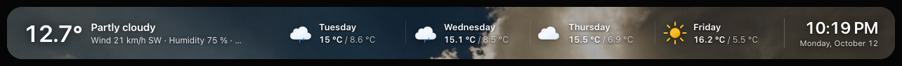
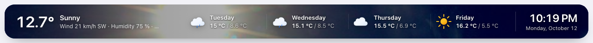
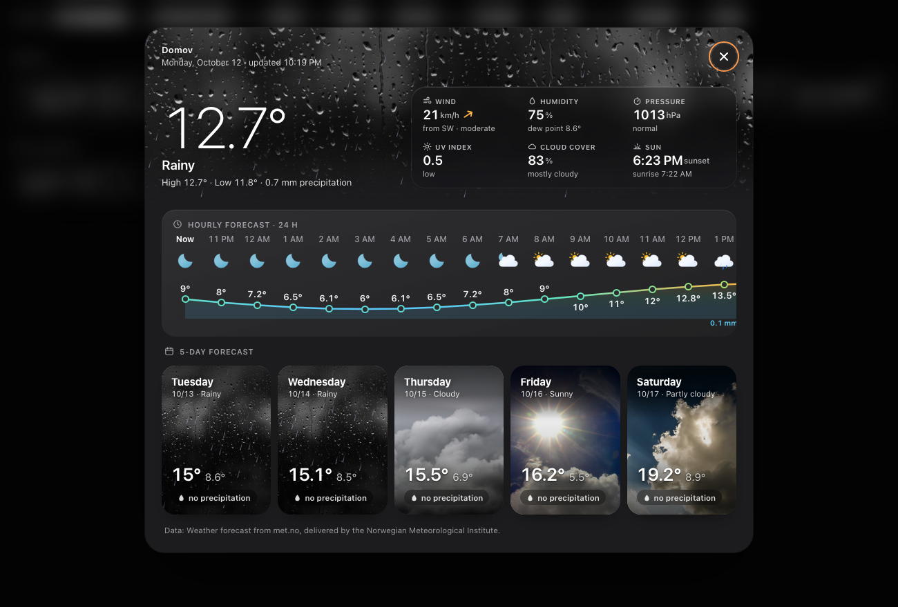
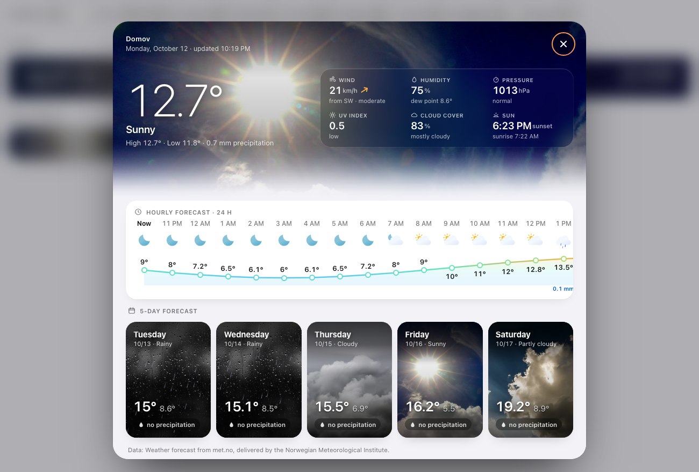
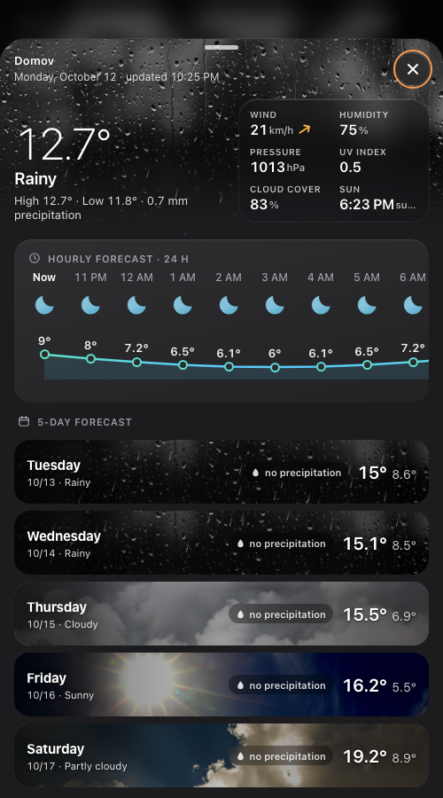

# Weather Bar Card

[](https://hacs.xyz/docs/faq/custom_repositories/)
[](https://github.com/eMalinos/weather-bar-card/actions/workflows/validate.yml)
[](https://github.com/eMalinos/weather-bar-card/releases)

A full-width weather bar for the top of a Home Assistant dashboard. On the left is a photo of the current weather that fades into the bar, then the forecast for the next days, and a clock on the right. Click the bar to open a weather detail with an hourly curve, current conditions and a 5-day forecast on weather photos.




| Detail (dark) | Detail (light) | Phone |
|---|---|---|
|  |  |  |

## Features

- **Photo of the current weather**: 12 photos (day/night variants) across the whole bar, or on the left with a soft fade (`photo: side`).
- **Optional effects**: animated rain, snow and lightning in the bar, the detail and each forecast day.
- **Forecast**: animated [Meteocons](https://github.com/basmilius/weather-icons) icons, the full weekday name and day/night temperature (e.g. `15 °C / 8.6 °C`). The number of days adapts to the card width.
- **Readable on any theme**: light text on a darkened photo; with `photo: side` on a light dashboard, forecast days that lie on the photo switch to light text.
- **Compact mode**: below `compact_width` (phones) the card collapses into a small pill with temperature, condition and clock.
- **Weather detail on click**:
  - the condition photo with the current temperature and today's high/low
  - a 24-hour hourly curve with icons and precipitation
  - current details: wind with direction, humidity with dew point, pressure, UV index, cloud cover, sunrise/sunset
  - 5 forecast days on condition photos
  - On screens narrower than 700 px it opens as a bottom sheet. Close it with Esc, ✕ or a click outside.
- **Follows Home Assistant**: dark/light mode, language, 12/24-hour clock. Each can be overridden per card.
- **Units**: °C or °F with automatic conversion. Wind and pressure use the entity's units.
- **Visual editor**: all common options can be set in the dashboard UI.

## Requirements

- Home Assistant **2023.9** or newer. The card uses the `weather/subscribe_forecast` websocket API.
- A `weather.*` entity with a **daily** forecast. An **hourly** forecast is used by the detail if the integration provides it, as Met.no does.
- `sun.sun` (default in HA) for night photos, night icons and sunrise/sunset.

## Installation

### HACS (recommended)

1. HACS → ⋮ (top right) → **Custom repositories**.
2. Repository: `https://github.com/eMalinos/weather-bar-card`, type: **Dashboard** → **Add**.
3. Search for **Weather Bar Card** in HACS → **Download**.
4. Reload the browser (HACS adds the dashboard resource automatically).

Once the card is accepted into the HACS default store, steps 1–2 won't be needed.

### Manual

1. Download the `dist/` folder from the [latest release](https://github.com/eMalinos/weather-bar-card/releases).
2. Copy **all** of its files to `/config/www/weather-bar-card/`. The photos and icons must be next to `weather-bar-card.js`.
3. Settings → Dashboards → ⋮ → **Resources** → **Add resource**:
   - URL: `/local/weather-bar-card/weather-bar-card.js?v=1.2.0`
   - Type: **JavaScript module**
4. Hard-reload the browser. In the companion app use Settings → Companion app → Debugging → Reset frontend cache.

After an update, change the `?v=` number in the resource URL so browsers drop the cached file.

## Usage

```yaml
type: custom:weather-bar-card
entity: weather.forecast_home
name: Home
shape: floating
```

In a **sections** view, put the card in its own section and set its width to *full*. Or use `grid_options: { columns: full }`.

## Options

| Option | Default | Description |
|---|---|---|
| `entity` | – | `weather.*` entity (**required**) |
| `name` | entity name | location name in the detail header |
| `sun_entity` | `sun.sun` | used for night photos, night icons and sunrise/sunset |
| `theme` | `auto` | `auto` follows HA dark mode, or `dark` / `light` |
| `photo` | `full` | `full` = photo across the whole bar, `side` = photo on the left fading into the bar colour |
| `tint` | `neutral` | with `photo: side`: `neutral` = grey bar, `photo` = bar tinted by the photo's colour |
| `shape` | `edge` | `edge` = square corners (edge-to-edge strip), `floating` = rounded card |
| `forecast_days` | `5` | maximum forecast days in the bar; fewer are shown when they don't fit |
| `compact_width` | `600` | below this card width (px) the compact pill is used |
| `show_clock` | `true` | clock and date on the right |
| `effects` | `true` | rain / snow / lightning animation (disabled with *reduce motion*) |
| `detail` | `true` | click opens the weather detail; `false` = HA's standard more-info dialog |
| `unit` | `auto` | `auto` = unit of the entity, or `°C` / `°F` (converted) |
| `language` | `auto` | `auto` = HA profile language, `browser` = browser language, or a language code (`en`, `cs`, …) |
| `time_format` | `auto` | `auto` = HA profile setting, or `12` / `24` |
| `image_path` | folder of the card file | folder with the `<photo-key>.jpg` photos |
| `icon_path` | same as `image_path` | folder with the Meteocons `<name>.svg` icons |
| `images` | `{}` | per-photo override, e.g. `images: { sunny: /local/my-sun.jpg }` |

Full example:

```yaml
type: custom:weather-bar-card
entity: weather.forecast_home
name: Home
theme: auto
photo: full
tint: neutral
shape: floating
forecast_days: 4
compact_width: 600
show_clock: true
effects: true
detail: true
unit: auto
language: auto
time_format: auto
images:
  sunny: /local/photos/my-sunny-garden.jpg
```

### Own photos

Photo keys: `sunny`, `clear-night`, `partlycloudy`, `partlycloudy-night`, `cloudy`, `fog`, `rainy`, `pouring`, `lightning-rainy`, `snowy`, `snowy-rainy`, `windy`.

HA's `hail`, `lightning`, `windy-variant` and `exceptional` reuse one of these. Override single photos with `images`, or point `image_path` to a folder with all of them. Landscape photos around 960 × 640 px work well.

### Languages

The forecast, dates and numbers use any language your browser supports. Condition names come from Home Assistant's own translations. The card's own labels ("Wind", "Hourly forecast", …) are translated to **English** and **Czech**; other languages fall back to English. Pull requests with more languages are welcome. The strings are in `I18N` and `DETAIL_I18N` in `dist/weather-bar-card.js`.

## Development

No build step: the card is a single vanilla web component in `dist/weather-bar-card.js`.

```bash
node --test tests/*.test.mjs   # unit tests of the pure logic
python3 -m http.server 8765     # then open http://localhost:8765/demo.html
```

`demo.html` renders the card with a mocked `hass`. URL parameters preset the controls, e.g. `demo.html?cond=rainy&theme=light&language=en&open=1`. `open=1` opens the detail.

Releasing: bump `VERSION` in `dist/weather-bar-card.js`, then tag `vX.Y.Z` and publish a GitHub release. HACS installs from releases.

## Credits

- Weather icons: [Meteocons](https://github.com/basmilius/weather-icons) by Bas Milius, MIT license (`dist/METEOCONS-LICENSE`).
- Photos: CC0 / public domain, found via [Openverse](https://openverse.org/); sources are listed in `dist/CREDITS.json`.
- Inspired by the [clock-weather-card](https://github.com/pkissling/clock-weather-card) icon style.

## License

[MIT](LICENSE) © 2026 Karel Malina
